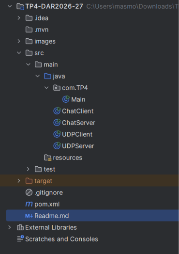
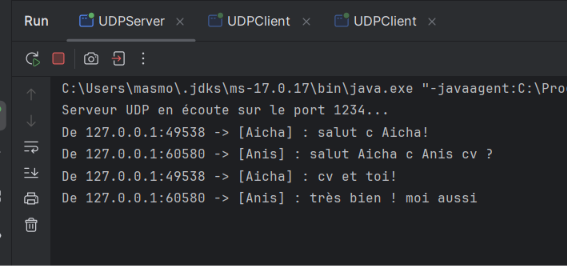
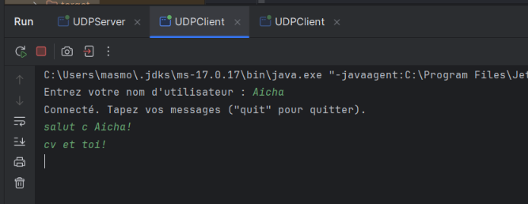
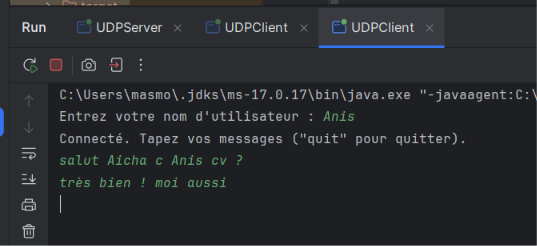
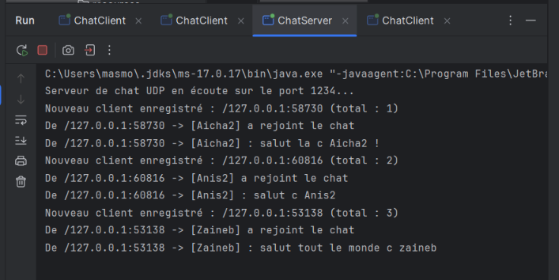
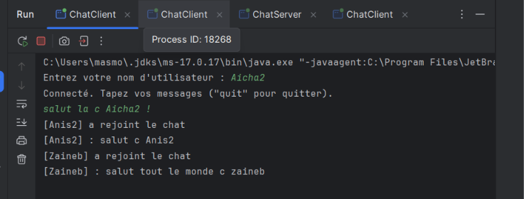
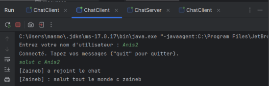
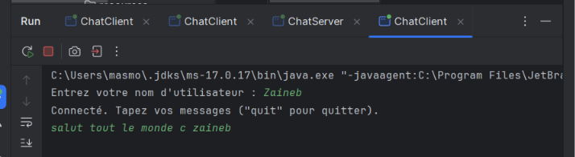

# TP 4 : Sockets en mode non-connecté UDP — Service de Chat Client/Serveur

**Auteur :** *Aicha Masmoudi*

## Objectif

Mettre en place un service de chat client/serveur en Java avec des sockets UDP (`DatagramSocket` / `DatagramPacket`), d'abord de façon unidirectionnelle, puis de façon bidirectionnelle avec diffusion des messages à plusieurs clients.

## Structure du projet

## Étape 2 : Chat unidirectionnel 

### Principe

- **Serveur (`UDPServer`)** : un `DatagramSocket` est créé puis lié au port **1234** avec `bind(new InetSocketAddress(1234))`.
Une boucle appelle `receive()` (bloquant) et affiche pour chaque datagramme l'adresse IP, le port de l'expéditeur et le contenu du message.
- **Client (`UDPClient`)** : demande un nom d'utilisateur, lit les lignes saisies au clavier et envoie chacune au serveur dans un `DatagramPacket`, préfixée par `[NomUtilisateur] : `.
Le port local du client est attribué automatiquement par le système.

### Captures

**Serveur : réception et affichage des messages avec l'adresse de l'expéditeur**

**Client 1**

**Client 2**

### Synthèse

Le serveur reçoit et affiche correctement les messages de chaque client avec leur adresse (`127.0.0.1` et un port différent par client, dans notre cas : `49538` et `60580`). 
La communication est **unidirectionnelle** : les clients ne voient pas les messages des autres, car le serveur se contente de les afficher.
Il n'y a pas d'établissement de connexion : chaque datagramme est indépendant.

---

## Étape 3 : Chat bidirectionnel et diffusion à plusieurs clients

### Principe

- **Serveur (`ChatServer`)** : maintient un `Set<SocketAddress>` des clients connus. À chaque message reçu :
    1. il enregistre l'adresse de l'expéditeur si elle est nouvelle ;
    2. il retransmet le message à tous les autres clients enregistrés, **sauf à l'expéditeur**.
- **Client (`ChatClient`)** : deux threads partagent le même `DatagramSocket` :
    - le thread principal lit le clavier et envoie les messages ;
    - un thread de réception (daemon) appelle `receive()` en boucle et affiche les messages diffusés.
- À son démarrage, le client envoie « [nom] a rejoint le chat ». En UDP il n'y a pas de connexion : c'est ce premier datagramme qui permet au serveur de l'enregistrer.

### Captures

**Serveur : enregistrement de trois clients et réception de leurs messages**

**Client Aicha2**

**Client Anis2**

**Client Zaineb**

### Synthèse

Le serveur enregistre chaque nouveau client (`total : 1`, `2`, `3`) et diffuse ses messages aux autres.
Ainsi, Aicha2 reçoit les messages d'Anis2 et de Zaineb, et Anis2 reçoit ceux de Zaineb. L'expéditeur ne reçoit pas son propre message.
L'échange se fait en temps réel grâce au thread de réception : sans lui, l'appel bloquant `receive()` empêcherait d'envoyer, et inversement.

On observe aussi une propriété d'UDP : un client ne reçoit que les messages envoyés **après** son enregistrement.
Par exemple, Zaineb n'a vu aucun message antérieur à son arrivée, et Anis2 n'a pas vu le premier message d'Aicha2. 
Le serveur ne conserve pas d'historique.

## Conclusion

Ce TP montre le fonctionnement du mode non-connecté : l'échange direct de datagrammes, l'identification des clients par leur `SocketAddress` et la nécessité de threads pour combiner émission et réception côté client.